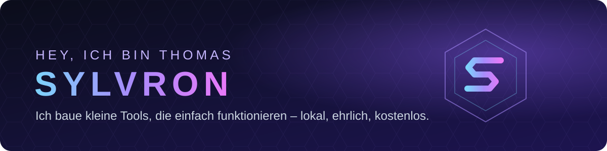

 

**Willkommen!** 👋 Schön, dass du vorbeischaust. 
Hier findest du meine Projekte unter dem Namen **Sylvron**: Apps, Smart-Home-Kram und Spiele. 
Fast alles läuft **lokal bei dir**, ohne Cloud und ohne Tracking.

[🌐 sylvron.de](https://sylvron.de) &nbsp;·&nbsp; [⭐ Projekte](#-was-ich-gerade-baue) &nbsp;·&nbsp; [💬 Kontakt](#-sag-hallo)

 

## ✨ Was ich gerade baue

<table>
<tr>
<td width="50%" valign="top">

### ⚡ [Sylvron Pulse](https://github.com/BadFameZz/sylvron-pulse)
**Dein Zuhause als lebendiger 3D-Kern**, eine HUD-Karte für Home Assistant mit dem Assistenten **CORE**. Er versteht ganz normale Sätze, merkt sich, worüber ihr redet, und lässt sich Neues beibringen. Ohne KI, ohne Cloud.

`Home Assistant` `HACS` `three.js` · 🧪 Beta, **Tester willkommen!**

</td>
<td width="50%" valign="top">

### 🎵 [Lindaris](https://github.com/BadFameZz/Lindaris)
**Audio-Visualizer für macOS.** System-Audio live visualisieren oder einen Song laden, eine Szene bauen und als MP4 exportieren.

`macOS` `Universal Binary` · ✅ Download verfügbar

### 🚗 [MileBack](https://github.com/BadFameZz/mileback-releases)
**Fahrtkosten berechnen und dokumentieren.** Lokal, kostenlos, ohne Tracker.

`Android` · ✅ Download verfügbar

### 📈 [AI Trade Lab](https://github.com/BadFameZz/Ai-Trade-Lab)
**Mein privates Paper-Trading-Labor** auf dem eigenen Server. Zum Lernen und Experimentieren, kein Gewinnversprechen.

`Python` `Proxmox` · 🔬 Experiment

</td>
</tr>
</table>

 

## 🧭 Wie ich arbeite

- 🏠 **Lokal zuerst:** Deine Daten bleiben bei dir.
- 🧩 **Einfach installieren:** auspacken, starten, fertig. Keine Bastelstunde.
- 🆓 **Kostenlos & offen:** Was hier liegt, darfst du nutzen.
- 🛠️ **Selbst gebaut:** von der Idee bis zum Release, Schritt für Schritt.

 

## 🛠️ Womit ich baue

 

## 💬 Sag hallo

Fragen, Ideen oder einen Fehler gefunden? Immer her damit!

- 🐞 **Bug oder Wunsch zu einem Projekt:** einfach ein *Issue* im jeweiligen Repo aufmachen
- 🌐 **Website:** [sylvron.de](https://sylvron.de)
- 🧪 **Sylvron Pulse testen:** Anleitung im [Repo](https://github.com/BadFameZz/sylvron-pulse#installation)

 

Mit ☕ gebaut in Sachsen-Anhalt · © 2026 Sylvron · Thomas (BadFameZz)

